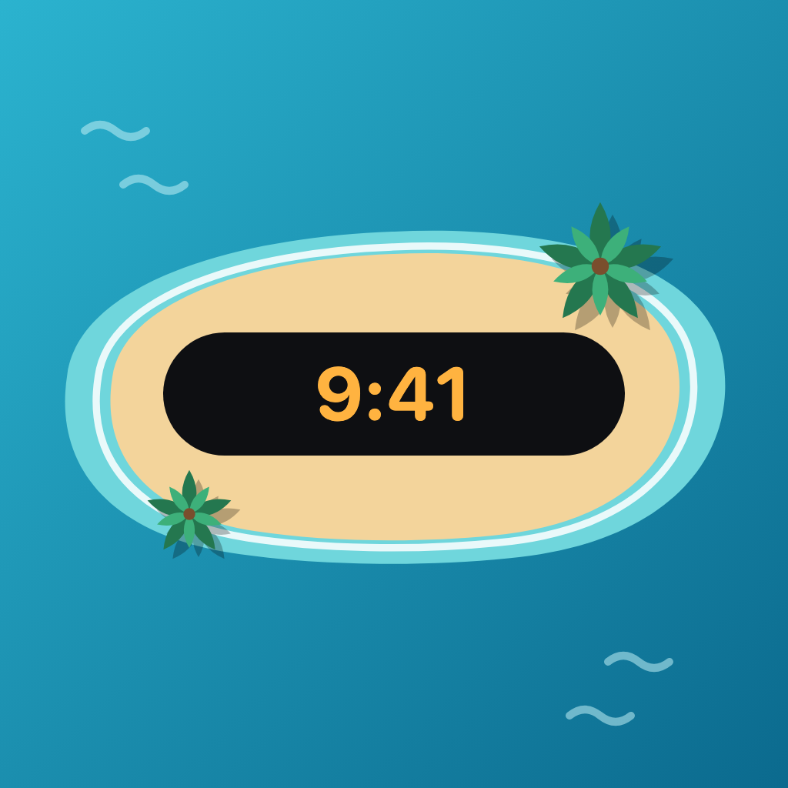

<p align="center">
  
</p>

<h1 align="center">
  섬타임 (SomTime)
  <p align="center">
  
  
  </p>
  <p align="center">
    <a href="https://apps.apple.com/kr/app/%EC%84%AC%ED%83%80%EC%9E%84/id6820983446">
      
    </a>
  </p>
</h1>


## 🏝️ 프로젝트 소개
<div align="left">
  <h3>영상을 보면서도 상단을 내리지 않고! &nbsp; 다이나믹 아일랜드 · PiP 시계</h3>
  <p>
    전체 화면으로 영상을 보거나 게임을 하다가 지금 몇 시인지 궁금해서 화면 위를 끌어내린 적 없으신가요?<br>
    <strong>섬타임</strong>은 다이나믹 아일랜드의 <strong>"섬"</strong>과 시계의 <strong>"타임"</strong>을 합친 이름처럼,<br>
    다이나믹 아일랜드와 PiP 플로팅 창에 시계를 띄워 어떤 화면에서도 시간을 바로 확인할 수 있게 해주는 앱입니다.<br>
    가로 모드 다이나믹 아일랜드(iOS 27+)까지 지원하며, 원하는 디자인과 색상으로 나만의 시계를 꾸밀 수 있습니다.<br>
    여기에 사이트의 <strong>서버 시간</strong>을 밀리초 단위까지 맞춰 띄워주어, 티켓팅 · 수강신청처럼 정확한 순간이 필요할 때도 든든합니다.
  </p>
</div>
<br>

## 📱 주요 기능

### 🏝️ 다이나믹 아일랜드 시계 (Live Activity)
* **토글 한 번으로 시작** : 홈에서 토글을 켜면 다이나믹 아일랜드와 잠금 화면에 현재 시각이 표시되어, 전체 화면 영상이나 게임 중에도 상단을 내리지 않고 시간을 확인할 수 있습니다.
* **상황별 최적 표시** : 다이나믹 아일랜드의 컴팩트 · 미니멀 · 확장 상태와 잠금 화면(StandBy)에 맞춰 시계를 각각 알맞게 배치합니다. 확장 화면에서는 날짜와 자동 종료까지 남은 시간도 함께 보여줍니다.
* **가로 모드 지원 (iOS 27+)** : 폭이 좁은 가로 모드 다이나믹 아일랜드에서는 카메라 위 · 아래 공간에 시 · 분과 초를 나눠 표시합니다.
* **자동 종료 안내 · 상태 복원** : Live Activity는 시스템 정책상 약 8시간 후 종료되므로 홈에서 "약 N시간 N분 후 자동 종료"처럼 남은 시간을 알려주고, 앱을 다시 실행해도 실행 중인 시계를 감지해 토글 상태를 그대로 복원합니다.

### 🖼️ PiP 플로팅 시계
* **영상 위에 떠 있는 작은 시계 창** : PiP(화면 속 화면) 창으로 시계를 띄워, 다른 앱 위에서도 항상 시간을 확인할 수 있습니다.
* **두 가지 창 비율** : 영상을 거의 가리지 않는 얇은 **10:1 막대형**과 모서리에 두기 좋은 **2:1 창형** 중에서 고를 수 있습니다.
* **자동 표시** : 시계를 켠 상태로 앱을 벗어나면 PiP 창이 자동으로 떠오르며, 재생 중인 음악이나 영상 소리는 끊지 않습니다.
* **기기별 대응** : 다이나믹 아일랜드가 없는 기기(노치 iPhone, iPad 등)에서는 PiP 시계를 주 기능으로 안내합니다.

### ⏱️ 서버 시간
* **사이트 서버 시각 측정** : 사이트 주소를 입력하고 측정을 누르면 그 사이트 서버의 시각을 맞춰, "내 폰보다 0.42초 빠름 · 오차 ±0.03초"처럼 내 폰과의 차이와 오차를 보여줍니다.
* **원하는 곳에 표시** : 측정한 서버 시간을 다이나믹 아일랜드 또는 PiP 플로팅 시계 중 원하는 곳에 띄울 수 있습니다.
* **밀리초 표시** : PiP에서는 밀리초까지 표시해, 티켓팅처럼 정확한 순간이 필요할 때 활용할 수 있습니다.
* **다시 맞추기** : 시계가 실행 중일 때 다시 측정하면 새로 맞춘 시각이 곧바로 시계에 반영됩니다.

### 🎟️ 티켓팅 연습
* **정각 클릭 연습** : 09:59:50부터 흐르는 연습 시계를 보고 10:00:00 정각에 예매하기를 누르면, 정각과의 차이를 밀리초 단위로 보여주고 "완벽해요 · 아주 좋아요"처럼 판정합니다. 누른 순간은 −0.5초 ~ +0.5초 타임라인 위에 표시됩니다.
* **포도알 클릭 연습** : 좌석 배치도에서 무작위로 뜨는 빈 좌석(포도알)을 찾아 누르고, 제한 시간 안에 예매하기까지 누르는 연습입니다. 결과 화면에서는 걸린 시간을 "좌석 선택"과 "예매하기까지"로 나눠 보여줍니다.
* **보안 문자 입력 연습** : 그림 속 무작위 영문 6자리를 대소문자 구분 없이 입력하고 입력 완료를 누르는 연습입니다. 틀리거나 새 문자로 바꿔도 시간은 이어서 재며, 결과 화면에서는 통과까지 걸린 시간과 틀린 횟수 · 새로고침 횟수를 보여줍니다.
* **난이도 · 좌석 사라짐** : 쉬움(5초) · 보통(3초) · 어려움(2초) 중에서 고르며, 다른 사람이 먼저 잡은 것처럼 빈 좌석이 하나씩 사라지고 고른 좌석도 뺏길 수 있어 실전처럼 연습할 수 있습니다.
* **연습 기록** : 정각 클릭의 최고 기록 · 최근 10회 평균 · 연습 횟수와 포도알 클릭 · 보안 문자 입력의 난이도별 최고 기록을 기기에 저장합니다.

### 🎨 나만의 시계 꾸미기
* **4가지 시계 디자인** : 기본 · 굵게 · 모노 · 도트(도트 매트릭스) 디자인을 가로 슬라이드로 골라볼 수 있습니다.
* **6가지 색상** : 화이트 · 앰버 · 민트 · 스카이 · 라벤더 · 코랄 중에서 고르며, 선택한 색상은 시계뿐 아니라 앱 전체의 **강조색**으로도 쓰입니다.
* **표시 옵션** : 24시간 / 12시간 형식, 초 표시, 오전/오후 표시를 원하는 대로 설정할 수 있습니다.
* **실시간 반영** : 설정 화면의 미리보기는 물론, 이미 켜져 있는 다이나믹 아일랜드 · PiP 시계에도 바뀐 설정이 즉시 적용됩니다.

### ⚙️ 설정
* **앱 언어** : 시스템 설정의 섬타임 페이지로 바로 이동해 앱 언어를 바꿀 수 있습니다.
* **문의하기** : 기기 · iOS · 앱 버전 정보가 자동으로 채워진 메일 작성 화면을 띄우고, 메일 앱을 쓸 수 없으면 문의 정보를 복사할 수 있습니다.
* **개인정보 처리방침** : 앱 안에서 바로 확인할 수 있습니다.

### 🌏 다국어 지원
* **한국어 · 영어 · 일본어** : String Catalog 기반으로 세 개 언어를 지원하며, 앱 이름도 언어에 맞게 **섬타임 / SomTime**으로 표시됩니다.

<br>

## 👥 팀 소개
| 프로필 | 이름 | 역할 | 담당 업무 | GitHub |
| :---: | :---: | :---: | :---: | :---: |
|  | **허성필** | **PM, iOS** | 프로젝트 매니징, Live Activity · PiP 시계 구현, <br> 서버 시간 측정, 설정 기능, UI 컴포넌트 개발 | [🔗](https://github.com/heopill) |

<br>

## 🛠 기술 스택 (Tech Stack)

| 분류 | 기술 명세 |
| :--- | :--- |
| **Architecture** | `TCA (The Composable Architecture)` |
| **UI Framework** | `SwiftUI`, `WidgetKit` |
| **Live Activity** | `ActivityKit (Dynamic Island / Lock Screen Live Activity)` |
| **Picture in Picture** | `AVKit (AVPictureInPictureController)`, `AVFoundation (AVSampleBufferDisplayLayer, AVAudioSession)`, `CoreMedia`, `CoreVideo` |
| **Async / State** | `Swift Concurrency (async/await, AsyncStream)`, `TCA Dependencies`, `Swift Sharing (@Shared)` |
| **Network** | `URLSession (HTTP Date 헤더 기반 서버 시각 측정)` |
| **Storage** | `App Group UserDefaults`, `App Group Container (File Storage)` |
| **System** | `WebKit(WebView)`, `MessageUI(Mail)`, `OSLog` |
| **Font** | `Pretendard`, `Doto` (위젯 확장은 서브셋 폰트 사용) |
| **Localization** | `String Catalog (.xcstrings)` — 한국어 / 영어 |
| **Deployment** | `iOS 18.0+`, `iPhone / iPad`, `Swift 5.0` |
| **Ads** | `Google Mobile Ads SDK (AdMob)`, `User Messaging Platform (UMP)` |

<br>

## 💡 기술적 의사결정 (iOS)

### 아키텍처 : TCA (The Composable Architecture)
* **단방향 데이터 흐름** : 시계는 홈의 아일랜드 · PiP 토글과 서버 시간 화면 등 여러 곳에서 켜고 끌 수 있어 상태가 꼬이기 쉽습니다. 모든 시계 전환을 `HomeFeature` 리듀서로 모아, 서버 시간 시계와 일반 시계가 동시에 켜지지 않는 규칙을 한 곳에서 보장했습니다.
* **기능 조합(Composition)** : 홈 · 설정 · 서버 시간 · 개인정보 처리방침을 각각의 `Reducer`로 분리하고 `@Reducer enum Destination`과 `ifLet`으로 화면 전환을 조합했습니다. 서버 시간 화면은 `delegate` 액션으로 시작 · 종료만 요청하고 실제 시계 제어는 홈이 맡아 책임을 나눴습니다.

### 의존성 관리 : TCA Dependencies
* **부수효과 격리** : Live Activity, PiP, 서버 시각 측정을 각각 `LiveActivityClient` · `PipClockClient` · `ServerTimeClient`로 정의하고 `@Dependency`로 주입해, ActivityKit · AVKit · 네트워크 같은 시스템 의존성을 리듀서 밖으로 분리했습니다.
* **교체 가능성** : `@DependencyClient`로 클라이언트를 추상화해, 테스트와 프리뷰 환경에서 손쉽게 대체할 수 있도록 설계했습니다.

### 상태 공유 : Swift Sharing + App Group
* **설정 즉시 반영** : 시계 디자인 · 색상 · 시간 형식을 `@Shared(.appStorage)`로 App Group `UserDefaults`에 저장해, 설정 화면에서 값을 바꾸는 즉시 홈 · Live Activity · PiP가 같은 값을 바라보도록 했습니다.
* **수명에 맞는 저장소 선택** : 서버 시간 측정 결과는 `fileStorage`로 App Group 컨테이너에, 실행 중인 서버 시간 시계는 `inMemory`로 관리해 데이터의 수명에 맞게 저장 위치를 나눴습니다.

### Live Activity 시계 : 시스템이 갱신하는 현재 시각
* **매초 업데이트 없이 흐르는 시계** : Live Activity는 앱이 매초 업데이트하는 구조가 아니므로, `Text(.currentDate, format:)`로 시스템이 직접 시각을 갱신하게 했습니다. 앱은 설정이 바뀔 때만 Live Activity를 업데이트합니다.
* **최소 지원 버전 iOS 18** : iOS 17에서 쓸 수 있는 `Text(timerInterval:)` 방식은 자정이 지나면 `24:00:xx`로 넘어가는 문제가 검증 과정에서 확인되어, 최소 지원 버전을 iOS 18.0으로 올렸습니다.
* **기기 설정과 무관한 시간 형식** : 지역 기반 `Date.FormatStyle`은 기기의 24시간제 설정에 따라 표시가 달라져, `Date.VerbatimFormatStyle`로 형식을 직접 지정했습니다. 한글 글자가 없는 폰트(모노 · 도트)의 12시간제는 "오후" 대신 AM/PM으로 표시합니다.
* **가로 모드 다이나믹 아일랜드** : `isDynamicIslandLimitedInWidth` 환경 값으로 분기해, 폭이 제한된 가로 아일랜드에서는 카메라 위에 시 · 분, 아래에 초를 나눠 그리고 `ViewThatFits`로 글자 크기를 단계적으로 맞췄습니다.
* **아카이브 용량 제한 대응** : 커스텀 폰트가 포함된 Live Activity 아카이브가 용량 제한을 넘어 시작 직후 종료되는 문제가 있어, 위젯 확장에는 필요한 글자만 담은 Pretendard 서브셋 폰트(약 59KB)를 포함했습니다.

### PiP 시계 : SwiftUI 화면을 영상 프레임으로
* **렌더링 파이프라인** : PiP는 영상만 띄울 수 있으므로, SwiftUI 시계 뷰를 `ImageRenderer`로 그려 `CVPixelBuffer` → `CMSampleBuffer`로 변환한 뒤 `AVSampleBufferDisplayLayer`에 넣어 `AVPictureInPictureController`로 띄웠습니다. 창을 키워도 선명하도록 6배 해상도로 그리고, 픽셀 버퍼 풀을 재사용합니다.
* **프레임 간격 최적화** : 일반 시계는 초가 바뀌는 순간에 맞춰 1초에 한 번만 그리고, 밀리초를 표시할 때만 약 30fps로 그려 배터리 소모를 줄였습니다.
* **다른 앱과의 공존** : 오디오 세션을 `.playback` + `.mixWithOthers`로 설정해 다른 앱의 소리를 끊지 않으며, `canStartPictureInPictureAutomaticallyFromInline`으로 앱이 백그라운드로 갈 때 PiP가 자동으로 시작되도록 했습니다.

### 서버 시간 측정 : HTTP Date 헤더 + 초 경계 탐색
* **Date 헤더 활용** : 사이트에 `HEAD`(막히면 `GET`) 요청을 보내 응답의 `Date` 헤더로 서버 시각을 얻습니다. 본문은 받지 않고 헤더가 도착하는 즉시 요청을 끊어 왕복 시간을 줄였습니다.
* **초 단위 한계 극복** : `Date` 헤더는 초 단위라, 응답 순간의 서버 시각이 `[S, S+1)` 범위에 있다는 점을 이용했습니다. 네트워크 지연을 왕복 시간의 절반으로 보정한 여러 표본의 범위를 교집합으로 좁혀, 폰 시각 대비 **오프셋과 오차(±)** 를 계산합니다.
* **초 경계 겨냥 요청** : 처음에는 1초 안의 여러 위치에 고르게 요청을 보내고, 이후에는 추정한 "서버 초가 바뀌는 순간"에 요청이 닿도록 시점을 맞춰 보내 오차 범위를 빠르게 좁혔습니다.
* **오프셋 적용** : 측정 결과는 오프셋으로 저장해 표시할 때 `폰 시각 + 오프셋`을 사용합니다. PiP는 밀리초까지 그대로 더하고, Live Activity는 시스템 갱신 텍스트에 오프셋만큼 옮긴 시간대(`TimeZone`)를 적용했습니다.

### 기기별 대응
* **다이나믹 아일랜드 판별** : 다이나믹 아일랜드 유무를 알려주는 공식 API가 없어 Safe Area inset으로 판별하고, 아일랜드가 없는 기기에서는 PiP를 주 기능으로 안내했습니다.

### 광고 : AdMob 배너 + UMP 동의
* **동의 → SDK 시작 → 광고 요청 순서 보장** : 앱 실행 시 홈에서 UMP로 동의 정보를 갱신하고, 동의가 필요한 지역(EEA · 영국 · 스위스)에서만 동의 창을 띄운 뒤 광고를 요청할 수 있을 때만 SDK를 시작합니다. 결과는 `@Shared(.adConsent)` 하나에 저장해 모든 화면의 배너와 설정 화면이 같은 값을 읽습니다.
* **화면별 광고 단위** : 홈 · 티켓팅 연습 · 설정 · 서버 시간에 광고 단위를 따로 두어 화면별 성과를 확인할 수 있게 했고, Debug 빌드는 Google 테스트 광고 단위로 고정해 개발 중 실제 광고 노출 · 클릭을 막았습니다.
* **레이아웃 안정성** : `safeAreaInset`으로 화면 하단에 고정하고, 동의 확인 · 로딩 중에는 배너 높이만큼 자리를 비워 두며, 광고를 받지 못하면 자리를 접어 레이아웃이 흔들리지 않게 했습니다.
* **배너 크기 선택** : SDK 13이 권장하는 large 배너(최대 150pt)는 시계 앱 화면에 너무 커서, 목업과 같은 높이(약 55pt)의 표준 적응형 배너를 선택했습니다.
* **실수 클릭 방지** : 빠르게 연달아 누르는 연습 화면과 키보드가 떠 있는 동안에는 배너를 넣지 않고, 버튼 · 카드와 24pt 이상 간격을 두며, 광고 소재가 배너 영역 밖으로 넘치지 않도록 잘랐습니다.

<br>

## 📸 App Previews

<p align="center">
  
  
  
  
  
  
  
</p>

<br>

## 🚀 Release History

| Version | Date | Description |
|:---|:---|:---|
| **v26.0.0** | 2026.10.10 | 첫 공식 배포 (Initial Release) |
| **v26.1.0** | 2026.10.15 | 티켓팅 연습 기능 추가 (정각 클릭, 포도알 클릭) |
| **v26.2.0** | 2026.10.20 | 애드몹(AdMob) 광고 배너 추가, 일본어 지원 |
| **v26.3.0** | 2026.10.22 | 목표 시각 카운트다운 · 알림 · 진동 기능 추가, PiP 시계 깜빡임 추가 |
| **v26.3.1** | 2026.10.26 | 보안 문자 연습 기능 추가, 목표 시간 10초 후 서버 시계 자동 꺼짐 기능 추가 |

<br>

## 🌳 프로젝트 구조

```
SomTime/
├── SomTime/                                # 앱 메인 타깃
│   ├── SomTimeApp.swift                    # 앱 진입점
│   ├── Info.plist                          # 앱 Info.plist (폰트, 백그라운드 오디오 모드, AdMob 앱 ID · SKAdNetwork)
│   ├── InfoPlist.xcstrings                 # 앱 이름 다국어 리소스 (섬타임 / SomTime)
│   ├── Localizable.xcstrings               # 다국어 문자열 리소스 (한국어 / 영어 / 일본어)
│   ├── SomTime.entitlements                # App Group 권한 (앱↔위젯 데이터 공유)
│   │
│   ├── Features/                           # 기능별 화면 모듈 (View · Feature)
│   │   ├── Home/                           # 홈 (시계 토글 · 미리보기, 시계 전환의 중심)
│   │   │   ├── HomeFeature.swift
│   │   │   ├── HomeView.swift
│   │   │   └── HomePreviewArea.swift       #  └ 아일랜드 · PiP 창 미리보기
│   │   ├── ServerTime/                     # 서버 시간 (측정 · 표시 방식 선택 · 시작)
│   │   │   ├── ServerTimeFeature.swift
│   │   │   ├── ServerTimeView.swift
│   │   │   └── ServerTimeModels.swift
│   │   ├── Settings/                       # 설정 (디자인 · 색상 · 표시 옵션 · 문의하기 · 광고 개인정보 설정)
│   │   │   ├── SettingsFeature.swift
│   │   │   ├── SettingsView.swift
│   │   │   └── MailComposeView.swift
│   │   ├── TicketingPractice/              # 티켓팅 연습 (정각 클릭 · 포도알 클릭)
│   │   │   ├── TicketingPracticeFeature.swift
│   │   │   ├── TicketingPracticeView.swift #  └ 연습 선택 화면
│   │   │   ├── TimingPracticeFeature.swift
│   │   │   ├── TimingPracticeView.swift    #  └ 정각 클릭 연습
│   │   │   ├── SeatPracticeFeature.swift
│   │   │   ├── SeatPracticeView.swift      #  └ 포도알 클릭 연습
│   │   │   └── TicketingPracticeModels.swift
│   │   └── PrivacyPolicy/                  # 개인정보 처리방침
│   │       ├── PrivacyPolicyFeature.swift
│   │       └── PrivacyPolicyView.swift
│   │
│   ├── Clients/                            # TCA Dependency Client
│   │   ├── LiveActivityClient.swift        # Live Activity 시작 · 업데이트 · 종료 (ActivityKit)
│   │   ├── PipClockClient.swift            # PiP 시계 시작 · 업데이트 · 종료
│   │   ├── ServerTimeClient.swift          # 서버 시각 측정 (HTTP Date 헤더)
│   │   └── AdClient.swift                  # 광고 동의 확인 · SDK 시작 · 광고 개인정보 설정
│   │
│   ├── Ads/                                # AdMob 배너 광고
│   │   ├── AdController.swift              # UMP 동의 처리 · Google Mobile Ads SDK 시작
│   │   ├── AdPlacement.swift               # 화면별 광고 단위 ID (Debug는 테스트 광고)
│   │   └── BannerAdView.swift              # SDK BannerView를 감싼 UIViewRepresentable
│   │
│   ├── PictureInPicture/                   # PiP 시계 구현
│   │   ├── PipClockController.swift        # AVPictureInPictureController · 오디오 세션 관리
│   │   └── PipClockFrameRenderer.swift     # SwiftUI 시계 → CMSampleBuffer 렌더링
│   │
│   ├── Components/                         # 공통 UI 컴포넌트
│   │   ├── AdBannerSlot.swift              # 화면 하단 광고 배너 자리
│   │   ├── Chip.swift
│   │   ├── ColorSwatch.swift
│   │   ├── DesignCard.swift
│   │   ├── DifficultyButton.swift
│   │   ├── FeatureCard.swift
│   │   ├── HomeTile.swift
│   │   ├── IconButton.swift
│   │   ├── IconTile.swift
│   │   ├── IslandPill.swift
│   │   ├── MiniSeatGrid.swift
│   │   ├── PipClockWindow.swift
│   │   ├── PracticeClockText.swift
│   │   ├── PracticeModeCard.swift
│   │   ├── PrimaryButton.swift
│   │   ├── RecordList.swift
│   │   ├── ResultIcon.swift
│   │   ├── ScreenHeader.swift
│   │   ├── SeatButton.swift
│   │   ├── SegmentedPicker.swift
│   │   ├── SelectionButton.swift
│   │   ├── SwitchIndicator.swift
│   │   ├── TimeBreakdownBar.swift
│   │   ├── ToastMessage.swift
│   │   ├── URLInputField.swift
│   │   └── WebView.swift
│   │
│   ├── Storage/                            # @Shared 저장 키
│   │   ├── AdSharedKeys.swift              # 광고 동의 상태 (inMemory)
│   │   ├── ClockSettingsSharedKeys.swift   # 시계 설정 (App Group UserDefaults)
│   │   ├── ServerTimeSharedKeys.swift      # 서버 시간 입력값 · 측정 결과 · 실행 상태
│   │   └── TicketingPracticeSharedKeys.swift  # 티켓팅 연습 기록 · 옵션 (앱 전용 저장소)
│   │
│   ├── Extensions/                         # 디자인 · 색상 · PiP 비율 · 난이도 표시 이름
│   │   ├── ClockColor+Name.swift
│   │   ├── ClockDesign+Name.swift
│   │   ├── PipAspectRatio+Name.swift
│   │   └── TicketingPractice+Name.swift
│   │
│   ├── Utilities/
│   │   ├── DeviceCapability.swift          # 다이나믹 아일랜드 · PiP 지원 여부 판별
│   │   └── UINavigationController+SwipeBack.swift  # 스와이프 백 제스처
│   │
│   ├── Resources/                          # 개인정보 처리방침 HTML (ko / en / ja)
│   └── Assets.xcassets/                    # 앱 아이콘
│
├── Shared/                                 # 앱 · 위젯 확장 공유 코드
│   ├── ClockActivityAttributes.swift       # Live Activity 공유 Attributes
│   ├── ClockDisplaySettings.swift          # 시계 표시 설정 묶음 (서버 시간 오프셋 포함)
│   ├── ClockSettingsStorage.swift          # App Group UserDefaults 키 · 기본값
│   ├── ClockTimeFormatter.swift            # 시각 문자열 형식 (VerbatimFormatStyle)
│   ├── ClockDesign.swift                   # 시계 디자인 (기본 · 굵게 · 모노 · 도트)
│   ├── ClockColor.swift                    # 시계 색상 6종 · 강조색
│   ├── PipAspectRatio.swift                # PiP 창 비율 (10:1 · 2:1)
│   ├── ServerTimeClock.swift               # 서버 시간 시계 정보 (호스트 · 오프셋)
│   ├── DesignMetrics.swift                 # 디자인 수치
│   ├── FontStyle.swift                     # 폰트 스타일 정의
│   ├── SharedAssets.xcassets/              # 디자인 토큰 · 시계 색상 에셋
│   └── Fonts/                              # Pretendard, Doto
│
└── SomTimeWidget/                          # 위젯 익스텐션 타깃 (다이나믹 아일랜드 / Live Activity)
    ├── SomTimeWidgetBundle.swift           #  └ 위젯 번들 진입점
    ├── ClockLiveActivity.swift             #     잠금 화면 · 다이나믹 아일랜드 UI
    ├── IslandClockViews.swift              #     컴팩트 · 미니멀 · 가로 모드 시계 뷰
    ├── LiveClockText.swift                 #     시스템이 갱신하는 현재 시각 텍스트
    ├── Fonts/                              #     Live Activity 용량 제한용 Pretendard 서브셋
    ├── Localizable.xcstrings               #     위젯 다국어 문자열
    ├── SomTimeWidgetExtension.entitlements #     위젯 App Group 권한
    └── Info.plist                          #     위젯 익스텐션 Info.plist
```
## License
Copyright © 2026 Seongpil Heo. All rights reserved.
